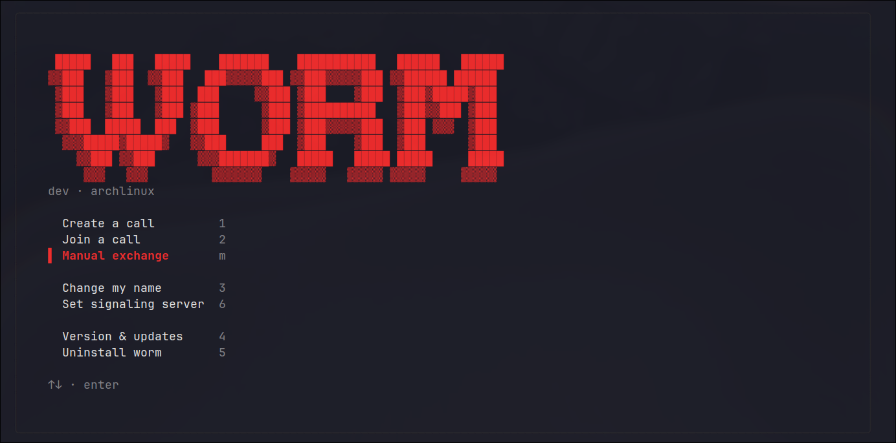
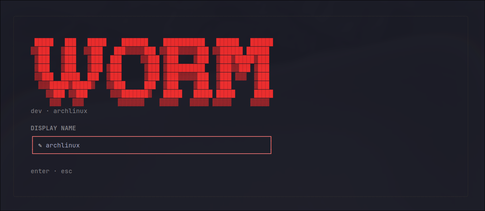

# worm

Terminal voice calls over WebRTC: a TUI client and a signaling server in a single Go
repository. Audio flows peer-to-peer whenever the network allows it and falls back to an
embedded TURN relay when it does not. The server never sees or relays media.

- two-party calls, no accounts, no address book — identity comes from a signed session;
- two ways to connect: a signaling server, or a manual SDP/ICE code exchange with no server
  at all;
- PCM L16 audio over RTP (both ends are worm, so no Opus codec is needed);
- a scarlet-on-black TUI that stays out of the way;
- self-update and uninstall straight from the TUI.





## Quick start

### Install

Linux or macOS (amd64/arm64), one command:

```bash
curl -fsSL https://raw.githubusercontent.com/Alice088/worm/master/install.sh | bash
```

The installer detects the platform, downloads the latest release, verifies `sha256`, installs
`worm` and `worm-server` into `~/.local/bin`, and adds that directory to `PATH` (restart the
shell afterwards). Verify with `worm --version`.

### Make a call

```bash
worm
```

Nothing to configure up front: the display name defaults to your hostname and settings are
stored in `~/.worm/config`.

- **No server?** Press `m` for **Manual exchange**, create an offer, send the code to the
  peer, and paste the answer code back. Zero setup, no accounts.
- **Have a server?** Press `6`, paste the server URL once — or start your own with
  `WORM_SECRET='change-me-at-least-16-chars' worm-server` — then use **Create a call** and
  **Join a call** like a phone.

Everything stays editable later from the same menu: `3` changes the name, `6` the server,
`4` checks for updates, `5` uninstalls.

Live audio requires Linux with ALSA utilities (`arecord`, `aplay`). Without them the UI,
signaling, and code exchange still work, but a call fails with an `audio device` error.

### Install management

```bash
# update to the latest release
curl -fsSL https://raw.githubusercontent.com/Alice088/worm/master/install.sh | bash -s -- --update

# pin a version
curl -fsSL https://raw.githubusercontent.com/Alice088/worm/master/install.sh | bash -s -- --version v1.2.3

# uninstall (keeps ~/.worm), or --purge to remove config as well
curl -fsSL https://raw.githubusercontent.com/Alice088/worm/master/install.sh | bash -s -- --uninstall
curl -fsSL https://raw.githubusercontent.com/Alice088/worm/master/install.sh | bash -s -- --uninstall --purge

# custom directory, no PATH changes
curl -fsSL https://raw.githubusercontent.com/Alice088/worm/master/install.sh | bash -s -- --dir /usr/local/bin --no-path
```

The same actions are available in the TUI under **Version & updates** and
**Uninstall worm**.

### Keyboard reference

Main screen: `1` create, `2` join, `m` manual exchange, `3` rename, `6` server,
`4` updates, `5` uninstall, `↑/↓` + `enter` to navigate, `ctrl+c` to quit.

Call screen: `←/→` move focus, `a` accept, `r` reject, `m` mute, `c` copy invite,
`q`/`esc` end or cancel.

Manual screen: `c` copy code, `s` save code, `m` mute, `enter` connect, `esc` back.

## How it works

A call is a one-to-one conversation between exactly two participants. There are two ways to
bring them together:

**A. Through the signaling server** — convenient when both peers can reach the server and
want incoming calls.

**B. Manual SDP + ICE exchange** — no server at all. One peer creates an offer and sends the
code over any channel, the other pastes it and returns an answer code. This is the
"call without infrastructure" mode.

Server-mode scenario:

1. The user starts `worm` with `server=` configured (or `WORM_SERVER` set).
2. **Create a call** registers the client, creates a call, and shows an **invite code**
   (hex). It contains the server address, `call_id`, a one-time signed invitation token,
   and the caller's name.
3. The second user picks **Join a call** and pastes the code. The client shows an incoming
   call; it must be accepted explicitly (`a`) or rejected (`r`).
4. After acceptance the clients exchange SDP and ICE and establish the media path. The
   server marks the call `connected` only when **both** clients report that their
   PeerConnection and ICE are connected and media is flowing. A finished SDP exchange alone
   does not make a call established.
5. Either participant can end the call (`q`). The caller can cancel a call that has not been
   accepted yet. Rejection and cancellation reach the other side; terminal states are
   immutable.

Manual-mode scenario:

1. **Create offer** → offer code (SDP + ICE) → send it to the peer.
2. Peer: **Answer an offer**, paste the offer code, get an answer code, send it back.
3. Caller pastes the answer code → ICE/DTLS complete and audio flows directly.
4. Later ICE candidates are exchanged as extra codes through **PASTE MORE CANDIDATES**.

Domain rules:

- A call has exactly two participants; identity always comes from the authenticated
  session, never from a message payload.
- Calls and invitations have deadlines: invitation timeout and connection timeout. Expired
  calls become `timeout`/`failed`.
- Repeated requests with the same `request_id` do not create a second call and do not repeat
  effects.
- A signaling socket drop does not tear down established media: a reconnect grace window
  applies, the client reconnects with backoff, and asks for current state
  (`connection.recover`).
- One participant cannot be in two active calls at once.
- The invite code is a capability: without it a `call_id` is useless, and brute-forcing
  `call_id` grants no access.
- TURN credentials are short-lived. Direct P2P is preferred but not guaranteed: some NATs
  require a relay.

What the user sees:

- main screen: server, name, **Create a call** / **Join a call** / **Manual exchange** /
  **Change my name** / **Set signaling server** / **Version & updates** /
  **Uninstall worm**;
- call screen: participants, state (`ringing`, `accepted`, `connecting`, `connected`,
  `ended`, …), invite code, quality (`rtt`, `jitter`, `loss`, `direct`/`relayed via turn`),
  controls (accept/reject/mute/copy/end), and readable errors.

## Architecture

```
cmd/main.go            TUI client
cmd/worm-server        signaling server

internal/protocol      versioned typed messages, validation, error codes
internal/call          authoritative call state machine, timeouts, idempotency
internal/auth          HMAC-signed session tokens
internal/signaling     WebSocket transport: auth, routing, rate limit, buffers
internal/turnserver    embedded TURN server (pion/turn) and short-lived credentials
internal/metrics       Prometheus metrics and /metrics
internal/server        HTTP API, configuration, graceful shutdown, sweeper
internal/client        HTTP registration and WebSocket client with reconnect
internal/engine        WebRTC session: offer/answer, trickle ICE, RTP, stats, ICE restart;
                       Manual — the same media layer over hand-exchanged codes
internal/audio         PCM capture/playback (arecord/aplay) + null devices for tests
internal/session       invite-code and SDP/ICE-code formats
internal/tui           Bubble Tea UI (main screen, call screen, manual exchange)
internal/updater       GitHub release lookup, download, atomic binary replacement
```

Data flow:

1. `POST /v1/session {name}` → `user_id`, token, `ws_url`, ICE servers, and TURN credentials.
2. `GET /ws` (Bearer or `?token=`) is the only signaling channel. JSON messages, version 1.
3. The server validates schema, authorization, membership, state, and ordering; SDP/ICE go
   only to the other participant. ICE/SDP for an offline participant are buffered (bounded)
   until it reconnects.
4. Call state is broadcast to both participants (`call.state`); errors arrive as
   `call.error` with a code (`invalid_state`, `forbidden`, `call_expired`,
   `participant_unavailable`, `rate_limited`, `not_found`, `internal_error`, …).

Responsibility boundaries:

- **call** — state transitions only, no network and no WebSocket.
- **signaling** — transport and routing; it does not keep its own copy of call state.
- **engine** — WebRTC/audio; every client report is untrusted and validated by the server
  (membership, allowed state, metric ranges).
- TURN is embedded and optional: without it the server hands out STUN only.

Protocol (v1): `call.create`, `call.incoming`, `call.accept`, `call.reject`, `call.cancel`,
`call.end`, `call.state`, `call.error`, `webrtc.offer`, `webrtc.answer`,
`webrtc.ice_candidate`, `webrtc.ice_candidate_complete`, `webrtc.renegotiate`,
`connection.recover`, `connection.status`, `ping`, `pong`.

Call states: `ringing → accepted → connecting → connected → ended`; terminal alternatives:
`rejected`, `cancelled`, `timeout`, `failed`.

Media: Opus is not used — clients exchange PCM L16 (48 kHz, mono) in RTP because both ends
are worm. A 10 ms frame (960 bytes) fits the MTU. Mute closes the capture device instead of
zeroing samples.

Observability: JSON logs with `user_id`/`call_id`; metrics `worm_call_*`, `worm_signaling_*`,
`worm_media_*`, `worm_turn_*`, `worm_websockets_active`, `worm_http_requests_total`, plus the
standard Go/process collectors.

Self-update: `internal/updater` asks the GitHub Releases API for the latest tag, downloads
`worm_<version>_<os>_<arch>.tar.gz` plus `checksums.txt`, verifies `sha256`, and replaces the
running binary atomically. The update takes effect after restart. The same release assets
back `install.sh`.

## Configuration

### Client

Set the server from the TUI (`6`) or write `~/.worm/config` directly; the display name
defaults to the hostname:

```ini
name=alice
server=http://127.0.0.1:8080
```

| Variable | Purpose |
|---|---|
| `WORM_HOME` | config directory override (default `~/.worm`) |
| `WORM_SERVER` | signaling server URL, overrides `server=` from the config |
| `GITHUB_TOKEN` | optional token for GitHub API calls during update checks (rate limits) |

STUN defaults to `stun:stun.l.google.com:19302`. For relay, add a TURN server to the client
`ICEServers`; in server mode TURN credentials arrive automatically.

### Server

| Variable | Default | Purpose |
|---|---|---|
| `WORM_SECRET` | required | signs tokens and invite codes (≥16 characters) |
| `WORM_LISTEN` | `:8080` | HTTP/WebSocket address |
| `WORM_PUBLIC_URL` | derived from request | external URL (`https://calls.example.com`) used for `ws_url` |
| `WORM_TOKEN_TTL` | `12h` | session token lifetime |
| `WORM_INVITE_TIMEOUT` | `60s` | how long a call rings |
| `WORM_CONNECT_TIMEOUT` | `30s` | how long to wait for media establishment |
| `WORM_CALL_RETENTION` | `5m` | keep terminal calls in memory |
| `WORM_RECONNECT_GRACE` | `20s` | wait for the signaling socket to return |
| `WORM_MAX_ACTIVE_CALLS` | `10000` | concurrent call limit |
| `WORM_TURN_LISTEN` | `:3478` | embedded TURN UDP address |
| `WORM_TURN_PUBLIC_IP` | auto | public IP for relay addresses |
| `WORM_TURN_REALM` | `worm` | TURN realm |
| `WORM_TURN_SECRET` | `WORM_SECRET + "/turn"` | TURN credential secret |
| `WORM_TURN_URLS` | derived from IP | TURN URL list handed to clients |
| `WORM_TURN_CRED_TTL` | `10m` | TURN credential lifetime |
| `WORM_TURN_DISABLED` | `0` | disable TURN |
| `WORM_ORIGINS` | — | allowed WebSocket origins |
| `WORM_ORIGINS_INSECURE` | `0` | disable origin checks (not for production) |
| `WORM_SHUTDOWN_TIMEOUT` | `15s` | graceful shutdown |

### HTTP API

| Method | Path | Purpose |
|---|---|---|
| `POST` | `/v1/session` | `{"name":"alice"}` → token, `ws_url`, ICE servers, TURN credentials |
| `GET` | `/v1/turn/credentials` | refresh TURN credentials with a Bearer token |
| `GET` | `/ws` | signaling WebSocket (Bearer or `?token=`) |
| `GET` | `/healthz` | liveness |
| `GET` | `/readyz` | readiness |
| `GET` | `/metrics` | Prometheus |

## Security and privacy

- every message and payload is validated by schema and size; SDP, ICE, and tokens are never
  logged;
- rate limits cover session creation, call creation, and signaling messages;
- TURN credentials are issued only to authorized sessions and live for minutes;
- metrics never use `user_id`/`call_id` as labels (unbounded cardinality protection).

## Troubleshooting

- `audio device` error — install ALSA utilities (`arecord`, `aplay`) and check the capture
  device; signaling and manual exchange work without audio.
- `server not configured` — press `6` and paste the server URL, or set `server=` in
  `~/.worm/config` / `WORM_SERVER`.
- Clipboard does not work (`c`) — worm uses `wl-copy`/`xclip`/`xsel`/`pbcopy`, then the
  OSC 52 escape sequence; over SSH or in unsupported terminals press `s` to save the code
  to `~/.worm/last-signal.txt`.
- Update fails with a permission error — the binary directory must be writable by the user
  running `worm`; reinstall with `--dir` into a writable location.
- Codes are truncated in the UI by design: the full value is always copied or saved intact.

## Development

Build:

```bash
make build VERSION=v1.2.3
make check
```

Without the Makefile:

```bash
go build -ldflags "-X main.version=v1.2.3" -o worm ./cmd
go build -ldflags "-X main.version=v1.2.3" -o worm-server ./cmd/worm-server
```

Tests:

```bash
go test ./...
go test -race ./...
go vet ./...
```

The heavy media test (`TestEndToEndCallWithMedia`) is skipped under `-race`: the DTLS
handshake under instrumentation does not fit the ICE timers, so the media path is covered by
a normal run while `-race` covers the remaining packages and lifecycle logic.

Releases are built by `.github/workflows/release.yml` on a `v*` tag: versioned binaries,
`worm_<version>_<os>_<arch>.tar.gz` archives, and `checksums.txt`.

Cut a release:

```bash
make release TAG=v1.2.3
git push --follow-tags origin master
```

`make release` refuses to tag a dirty tree, a non-`master` branch, a branch behind origin,
an existing tag, or failing checks. Pushing the tag starts the release workflow; wait for it
to finish before installing, otherwise the asset download returns 404.

## Limitations

No accounts or contact list (calls are invite- or SDP/ICE-code only); server call state lives
in a single process's memory; no recording or transcription; the media path assumes PCM L16
between two worm clients; live audio capture is implemented for Linux/ALSA.
